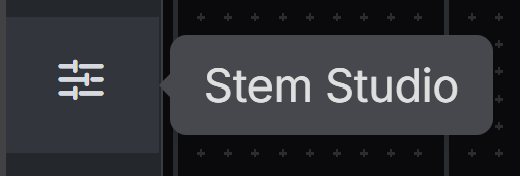

# Stem Studio for ComfyUI (node pack)

Separate a video's soundtrack into editable stems, pull single sounds out of it and paint new sounds into a timeline, with the Stem Studio workspace running **inside ComfyUI**. Everything runs on your own ComfyUI through its normal `/prompt` API: no partner nodes, no cloud APIs, no separate server. Open weights only. Code is MIT; model weights keep their own licenses (table below).

There is also a Windows desktop app with the same workspace: [Comfy-Stem-Studio](https://github.com/uniqornate/Comfy-Stem-Studio). This repository is the ComfyUI-native version. Status: implemented and covered by mock tests, **not yet confirmed in a real ComfyUI frontend**; please report what you see.

## What you get

- **Separation** of dialogue, music and effects with MERL MRX (default), BandIt v2 or SFC-Locoformer, and **six music stems** (vocals, drums, bass, guitar, piano, other) with HTDemucs.
- **Named sounds** with USS/PANNs (527 AudioSet classes, or all detected), and experimental **SAM Audio** (text, time examples, picture boxes) and **GuideSep** (pull an instrument by reference) on the whole source or a range.
- **Brush**: drag over a region of the timeline and paint a sound into a new channel with Stable Audio 3 Small-SFX or Medium, or with MMAudio so the sound follows the picture.
- A waveform **timeline**: mute, solo, level knobs and meters, non-destructive clip trim, split, move, copy, gain regions, undo and redo, loop ranges, multi-channel delete, takes to compare models, shortcut list on `?`.
- **Exports**: current mix to WAV or FLAC, lossless MKV with the new audio through ComfyUI's native SaveVideo, single or all stems, and **batch** processing of many files.
- **Long videos**: keep the video for preview, transfer only its original audio for separation, and process audio above the 96 MiB upload threshold in sequential sections. Completed sections appear at their source time on the timeline as they finish.
- **Projects**: autosave and resume the last workspace, reopen or rename saved projects, and relink source media when needed. Project records and timeline edits live under ComfyUI's native user and output directories.
- Ready-made ComfyUI workflows for the nodes without the UI: [`workflows/`](workflows/README.md).

## Install

1. Clone this repository into `ComfyUI/custom_nodes/` (or install it from ComfyUI Manager once it is published) and restart ComfyUI. Do not keep another copy of `custom_nodes/StemStudio` (for example from the desktop app) at the same time.
2. Find the **Stem Studio** icon in ComfyUI's navigation bar. It looks like three horizontal slider lines, and its tooltip says **Stem Studio**. The navigation bar may be on the left, top, or bottom depending on your ComfyUI layout. Click the icon to open the app in a new browser tab. If your browser blocks the new tab, use the button shown in the sidebar panel. You can also bookmark `http://127.0.0.1:8188/stemstudio/app/`.

   

3. Open **Connection**, tick the license box and download a model pack (MRX is the small default). Downloads are verified by hash and resume after an interruption.
4. Pick a video or audio file and separate.

Requirements: a recent ComfyUI, Python 3.10+, an NVIDIA GPU recommended (SAM Audio needs CUDA). A Chromium-based browser (Chrome, Edge) is recommended: choosing an output folder for batch and stem exports uses the File System Access API; other browsers download files one by one. Linux and macOS have not been tested.

## Where files go

| What | Where |
|---|---|
| Separator, USS, SFC, six-stem and brush model weights | `ComfyUI/models/audio_separation/<model>` |
| MMAudio weights | `ComfyUI/models/mmaudio` |
| MMAudio node pack (installed on request, pinned commit, every file hash-checked) | `ComfyUI/custom_nodes/ComfyUI-MMAudio` |
| Your source files | `ComfyUI/input/StemStudio/` |
| Results | `ComfyUI/output/StemStudio/<project>/` |
| Projects (references only, no copies) | `ComfyUI/user/default/stemstudio/projects/` |
| Private Python runtimes of SAM Audio and GuideSep | `ComfyUI/user/default/stemstudio/runtime` |

Preparation only starts from a button you press. Nothing is downloaded or installed when ComfyUI starts. MMAudio preparation installs the node pack's Python packages into ComfyUI's own Python (`pip`), which is the only step that changes ComfyUI's environment; the dialog says so before you agree. SAM Audio needs your own Hugging Face account, approval of its model pages and a read token; the token is used only for preparation and is not saved.

## Models and licenses

| Model | Use | Weights license | Open weights only? |
|---|---|---|---|
| MERL MRX (adapted loudness) | Default separator | MIT | Yes |
| BandIt v2 multilingual | Separator | CC BY-SA 4.0 (code Apache 2.0) | Yes |
| SFC-Locoformer Medium DnR | Optional separator | CC BY-NC-SA 4.0 | Non-commercial only |
| HTDemucs 6-source | Six music stems | MIT (Meta) | Yes |
| USS at_soft + PANNs Cnn14 | Named sound extraction | Apache 2.0 / CC BY 4.0 | Yes |
| SAM Audio (small/large tv) | Experimental extraction | SAM license, gated on Hugging Face | Gated access, review the license |
| GuideSep v1 | Experimental reference-guided separation | MIT | Yes |
| Stable Audio 3 Small-SFX / Medium + T5Gemma | Brush | Stability AI Community License | Open weights; commercial use limited by a revenue threshold |
| MMAudio large 44k v2 (+ node pack by kijai, MIT) | Brush that follows the picture | CC BY-NC 4.0 | Non-commercial only |

Pinned sources, sizes and hashes: `setup/models.json`, `setup/extra-models.json`. Vendored code and notices: `comfy_nodes/StemStudio/NOTICE.md`.

## Development

Node 22+ and Python 3.10+.

```
npm ci
npm test            # JS tests
npm run build       # typecheck and rebuild comfy_nodes/StemStudio/app (committed)
npm run make:models # regenerate setup/extra-models.json from src/shared
```

Python tests: `python -I test/web_routes_test.py` and the other `test/*_test.py` files (standard library plus the packages each file needs). Architecture: [docs/ARCHITECTURE.md](docs/ARCHITECTURE.md). The Comfy Registry file is `pyproject.toml`; `PublisherId` is empty on purpose until the owner sets it.
